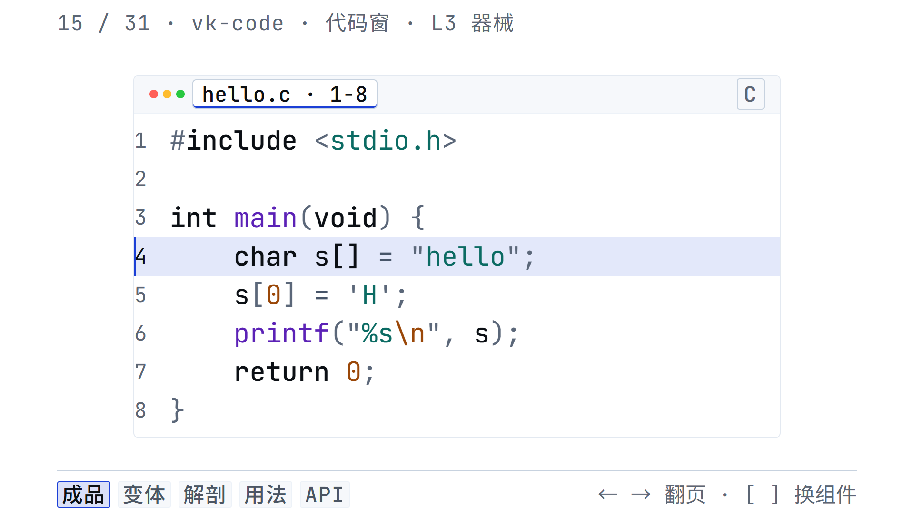

# vk · 画面语言

[](https://github.com/sanxiadaba/vk-video-kit/actions/workflows/ci.yml)
[在线标本册](https://sanxiadaba.github.io/vk-video-kit/) · [GitHub](https://github.com/sanxiadaba/vk-video-kit)

**English.** vk is a 5-layer visual language of 31 web components for building 1920×1080 frames for programming-explainer videos. Content is read from real files at build time (Shiki, KaTeX, hex dumps, JSON trees), the runtime is dependency-free, and the visual system is desktop-only with a 44px minimum type size. The showcase is a self-hosted specimen book: every page is a real frame, every visible element is a vk component. Documentation is Chinese-first; this paragraph is the English summary.

写一页能直接录进视频的画面。**31 个标签、5 层、1920×1080，桌面 only。**



## 五个原则

- **分则独立。** 每个标签离开兄弟节点也能成立：不伪造内容，不依赖父级上下文，不要求作者补一次性 CSS。
- **合则成帧。** 所有组件共享同一张 1920×1080 画布、同一个 1680×888 安全区、同一条 44px 字号地板。
- **真实文件是唯一真相。** 代码、终端、diff、树、字节、栈帧、公式都通过 `src` 指向真实文件；构建期编译，HTML 里不再出现第二份手敲内容。
- **静止即成品。** 没有播放器，也没有时间轴。`data-reveal` / `data-type` 只描述“动起来是什么样”，什么时候播由编排层决定。
- **展示站也是库。** 标本册的导航、镜头、变体控件、解剖标注全部由 vk 组件构成；帧外只有十几行灯箱 CSS。

## 五层

| 层 | 数量 | 标签 |
|---|---|---|
| L1 原子 | 6 | `vk-box` `vk-text` `vk-icon` `vk-img` `vk-rule` `vk-mark` |
| L2 排布 | 4 | `vk-stack` `vk-row` `vk-grid` `vk-canvas` |
| L3 器械 | 17 | `vk-title` `vk-list` `vk-tag` `vk-callout` `vk-code` `vk-term` `vk-diff` `vk-table` `vk-math` `vk-figure` `vk-browser` `vk-tree` `vk-keys` `vk-cells` `vk-bytes` `vk-frames` `vk-steps` |
| L4 关系 | 3 | `vk-edge` `vk-annotate` `vk-note` |
| L5 页面 | 1 | `vk-page` |

L3 只渲染一种**编程数据的形状**：源码、终端会话、差异、表格、公式、树、内存格、字节、栈帧、文件结构。时间线、语法、复杂度这类复合叙事不进库，用 canvas + box + edge 组合。

## 标本册

`npm run build` 生成的不是组件文档，而是一本 31 页的标本册：

- **索引**：一帧两栏，31 个条目，编号 / 标签 / 中文 / 层；←/→ 翻页。
- **每个组件一页**：页眉是编号与层；页脚是镜头栏；正文 1680×888。
- **五个镜头**（键盘 `1–5`）：
  1. **成品**：这个组件在真实讲解画面里的样子。
  2. **变体**：presets + 关键属性，现场改，画面现场重排。
  3. **解剖**：DOM 蓝图；栅格、包围盒、编号、部位尺寸，蓝图纸上的一次开膛。
  4. **用法**：它出现在哪些画面、最小片段、常一起出现的组件、设计规则。
  5. **API**：registry 生成的属性表，8 行/页，←/→ 翻页。
- **不滚动**：每个镜头都装进一张 1920×1080 帧里；装不下就分页。
- `Esc` 回索引，`[` / `]` 换组件；镜头写在 hash 里，可分享。

帧外的 `site/showcase.css` 只负责灯箱、隐藏、焦点和链接语义；帧内的可见元素全部是 vk。

## 快速开始

包尚未发布到 npm；先从本地路径安装：

```bash
npm i /path/to/vk-video-kit
```

```html
<link rel="stylesheet" href="node_modules/vk-video-kit/vk/fonts.css">
<link rel="stylesheet" href="node_modules/vk-video-kit/vk/vk.css">
<script src="node_modules/vk-video-kit/dist/vk.js"></script>

<vk-page align="center">
  <vk-stack gap="lg">
    <vk-title size="title" sub="改一个字符，改的是内存里的一个字节。">
      字符串不是值，是<em>一块内存</em>
    </vk-title>
    <vk-code lang="c" file="hello.c" src="code/hello.c" lines="1-8" highlight="4"></vk-code>
  </vk-stack>
</vk-page>
```

```bash
npx vk build page.html   # 读取 src，把高亮/公式/字节/树写进 HTML，产物自包含
npx vk serve 8099        # 开发服务器；改 .c 刷新即见
```

`file://` 下 `src` 取不到，请先跑 `vk build` 或 `vk serve`，不要直接双击 HTML。

## 真实数据

| 组件 | `src` 指向 | 构建期做什么 |
|---|---|---|
| `vk-code` / `vk-diff` | 源码 / diff | Shiki 高亮，token 级差异 |
| `vk-term` | transcript | 行分类，显式 ✓ / ! / ✗ |
| `vk-tree` | 真实目录 / `.json` | 目录扫描或 AST 归一 |
| `vk-bytes` | 真实二进制 | 十六进制 + ASCII + 地址切行 |
| `vk-frames` | 真实 `.json` | 栈帧与槽位 |
| `vk-math` | `.tex` | KaTeX 排版 |
| `vk-icon` | — | 按页注入用到的 Lucide SVG |

代码、终端、diff、树、字节、公式在运行时零依赖；没预编译时会显示 `data-vk-stale`，门禁直接失败。

## 两条视觉规则

1. **焦点只有一个颜色：冷钴蓝。** 它只做“底”——整行、关键词、当前步。代码关键字回到墨色、靠字重区分。
2. **语义色不写正文。** 对 / 错 / 注意只出现在色条、底色、图标上；正文永远是墨色。

还有一条硬线：**字不小于 44 设计像素**（1920 画布；手机横屏约 1/3 时 ≈14.7px）。行号、文件名、角标、页脚都在内；公式上下标是排版例外。

## 命令

```bash
npm run build       # 生成 _site/、dist/、vk/、types/ 与 metadata
npm run dev         # build 后启动 dev server（8099，服务 _site/）
npm run specimens   # 只重生成标本册
npm run verify      # 只读校验：生成物与源码不一致就失败
npm run test:fast   # verify + links + pack + 纯函数单测（需先 build）
npm test            # 全量：build + 静态 + 契约 + 渲染门禁 + 浏览器回归 + 单测
npm run contract    # 每个公开属性是否真的产生声明效果（4 路并行）
npm run gate        # 44px / 对比度 / 安全区 / 裁切 / console / 溢出
npm run links       # 站内链接门禁
npm run pack:check  # 包体文件数 / 体积 / 白名单
npm run shot -- _site/specimen/vk-code.html
```

`npm run build` 之后：`_site/` 是完整静态站（索引 + 31 张标本页 + 契约宿主 + 资源），`dist/` 与 `vk/` 是包产物。生成物都不进 git。

## 仓库结构

```
src/      运行时 + CSS 层 + registry + 标本数据（唯一真源）
cli/      随包发布的 CLI：build / serve
tools/    仅开发：registry 生成、scenes、标本册、契约、门禁
site/     灯箱与显示引擎（showcase.css / showcase.js）
code/     真实示例文件（含 .bin / .json）
docs/     设计说明 + 生成的属性参考
tests/    纯函数单测与浏览器回归
_site/    构建产物（gitignore）
```

## 包

`npm pack` 只带运行时、字体、CLI 与 editor metadata，不含标本册、门禁、截图、示例。`npm run pack:check` 会守住白名单与体积上限。

## 浏览器

桌面 Chromium / Edge（`target: chrome110`）。标本册是桌面 only；手机横屏观看由 1920 帧整体缩放保证。CI 只装 Chromium。

## 许可

MIT。字体 OFL 1.1、Shiki MIT、KaTeX MIT、Lucide ISC，见 [THIRD-PARTY-NOTICES.md](THIRD-PARTY-NOTICES.md)。
