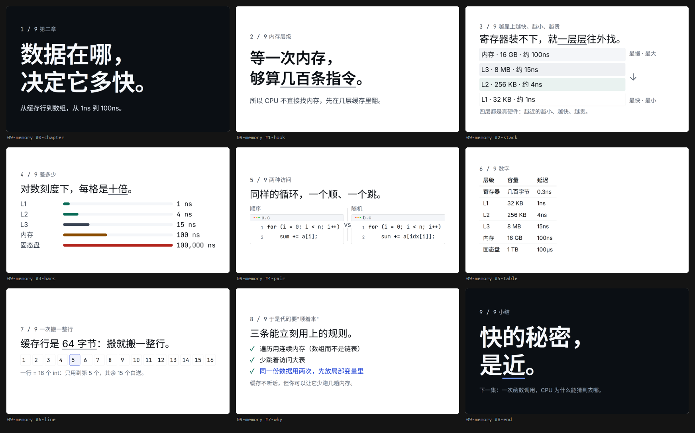

# vk · 单帧画面库

给编程科普视频用的**元素层**：把一个内容单元（代码 / 终端 / 改动 / 表格 / 树 / 字节 / 位 / 公式 / 图 / 文字）
画成 1920×1080 上正确、清晰、可测量的那个东西，再把若干单元摆进一帧。

- **不做**：文案、讲解架构、版面模板、时间轴 / 动画 / 播放 / 转场 / 录屏 / 渲染。
- **做**：27 个件、五种排布、一套词汇（六档字号 / 四个语义色 / 三档墨 / 一种纸）、
  构建期预编译（Shiki / KaTeX / hexdump / 树 / 图标）、客观自检、出图。
- **手机横屏基准**：1920 收到约 780 宽（0.406×），正文 56px ≈ 22.7 设备像素。

作者手册（给 AI 的入口）是 [SPEC.md](SPEC.md)；属性细节用 `vk doc <tag>`。



上面是 `episodes/09-memory.html` 的九帧原样缩略（`vk sheet` 出的联络图）：
深色章节页、钩子、嵌套盒子、对数横条、并置对照、表格、步骤、清单、深色收尾。

## 自查

`vk stats episodes/` 给每集出体检表；`npm run inert` 把每个件声明的属性逐个改一下，看有没有视觉变化——"声明了但没实现"的属性会在这里现形。它不是测试，是诊断。

## 素材

`npm run assets` 编 C 源码、生成 `.s` / `.o` / `.dis`；`npm run shots` 把 `assets/hello/asm.html` 里的两帧截成 `asm-o0.png` / `asm-o2.png`（`vk render --shot .vk-win` 只截窗口本身，不要画布留白）。

## 性能

这台机器上量过的数字：一帧约 0.2 秒（29 帧 6.0 秒，含构建与自检），联络图 29 帧约 9 秒。
所有帧都是一次加载、逐帧截图，帧数增加不改变单帧成本。

## 安装

```bash
npm install
npm run build        # 生成 vk/vk.css、vk/fonts.css、dist/vk.js
```

## 写一帧

一个文件只写 `<vk-page>`，其余由构建注入：

```html
<vk-page>
  <vk-stack gap="wide">
    <vk-label counter="1 / 4">内存</vk-label>
    <vk-text size="headline">字符串不是值，是<em>一块内存</em></vk-text>
    <vk-code id="c" lang="c" file="hello.c" current="2">
      <script type="text/plain" data-vk-source>
char s[] = "hello";
s[0] = 'H';
      </script>
    </vk-code>
  </vk-stack>
  <vk-callout mode="note" for="#c@line:2">把 H 写进第一个字节</vk-callout>
</vk-page>
```

```bash
vk render pages/01.html      # 构建 + 自检 + 出图（多帧文件一次出 N 张）
vk render pages/ --phone     # 780 宽，按手机尺度看
vk check  pages/             # 只自检
vk doc vk-code               # 一件的属性表
vk brief --json              # 全部件的契约
```

**构建只写 `out/`，不改源文件。**

## 自检判什么

只判客观错误：出画布 / 出安全区、内容被裁或截断、非覆盖层压字、字号低于 36px、
对比度不足、锚点指不到、渲染失败、数据过期、空帧。

**不判**焦点几个、留白多少、标题多长。好看不靠门禁，靠默认值和组件的自动适配：
代码窗放不下会自己缩字号，步骤条窄了会自己竖排，注释自动避开内容，表格数字自动右对齐。

## 测试

```bash
npm test        # schema / tokens / 文档一致性 + 全部验收帧（真浏览器，约 20s）
```

验收帧在 `tests/acceptance/`（真实教学内容，不是模板），组件总表在 `tests/sheet.html`、`tests/sheet2.html`、`tests/capabilities.html`、`tests/capabilities2.html`，
真分镜在 `episodes/`（一整段 6–10 帧的连续内容，也是回归用例）。

## 结构

```
src/vocab.mjs          唯一词表：字号 / 行高 / 间距 / 颜色 / 字体
src/schema.mjs         公开 API：27 个件、属性、默认值、子节点契约
src/build.mjs          构建期：校验 + 高亮 / 公式 / 字节 / 树 / 汇编 / 图标
src/runtime/           运行期：底座 / 排布 / 件 / 关系 / 自检
src/*.css              tokens(生成) → base → layout → components → callout
bin/vk.mjs             一条命令：render / check / doc / brief / icons
tools/                 字体 / 图标 / KaTeX / CSS 生成 / 打包 / 测试
tests/acceptance/      12 帧真实教学验收帧（回归用）
```

## 许可

MIT。字体 OFL 1.1、Shiki MIT、KaTeX MIT、Lucide ISC，见 [THIRD-PARTY-NOTICES.md](THIRD-PARTY-NOTICES.md)。
